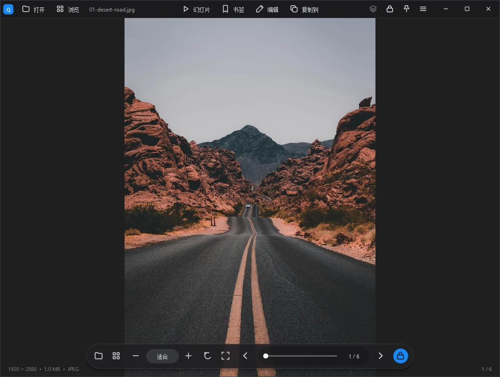
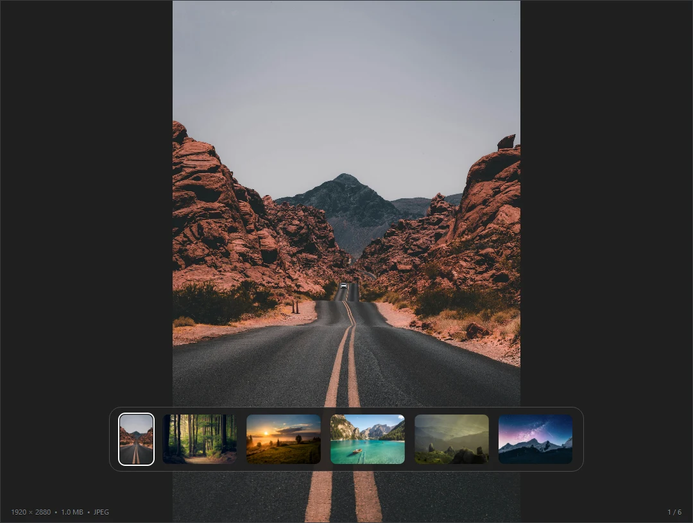
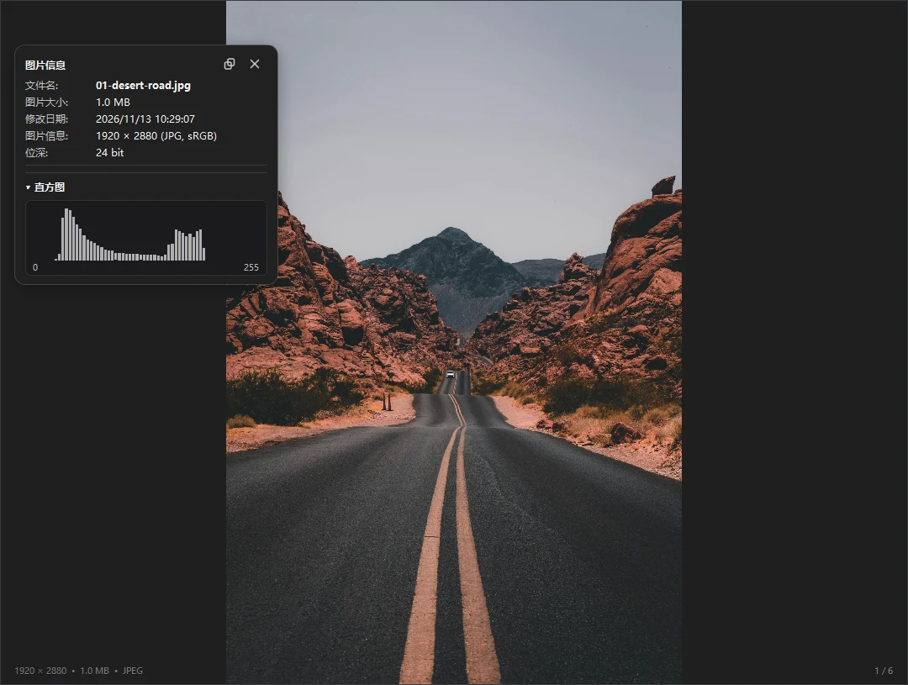
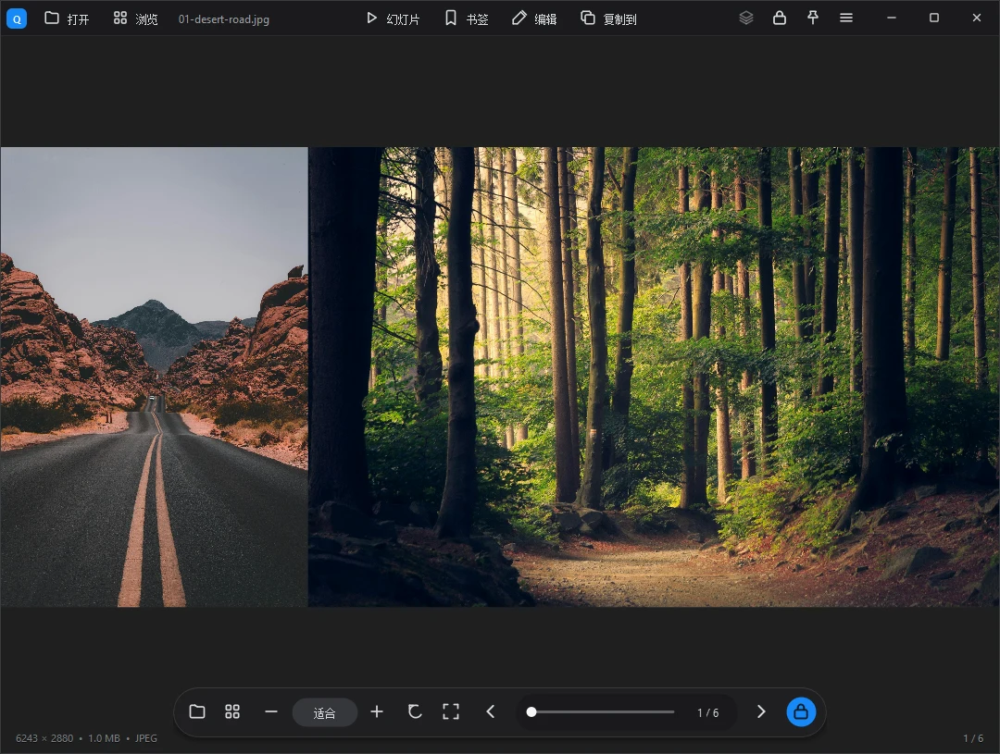
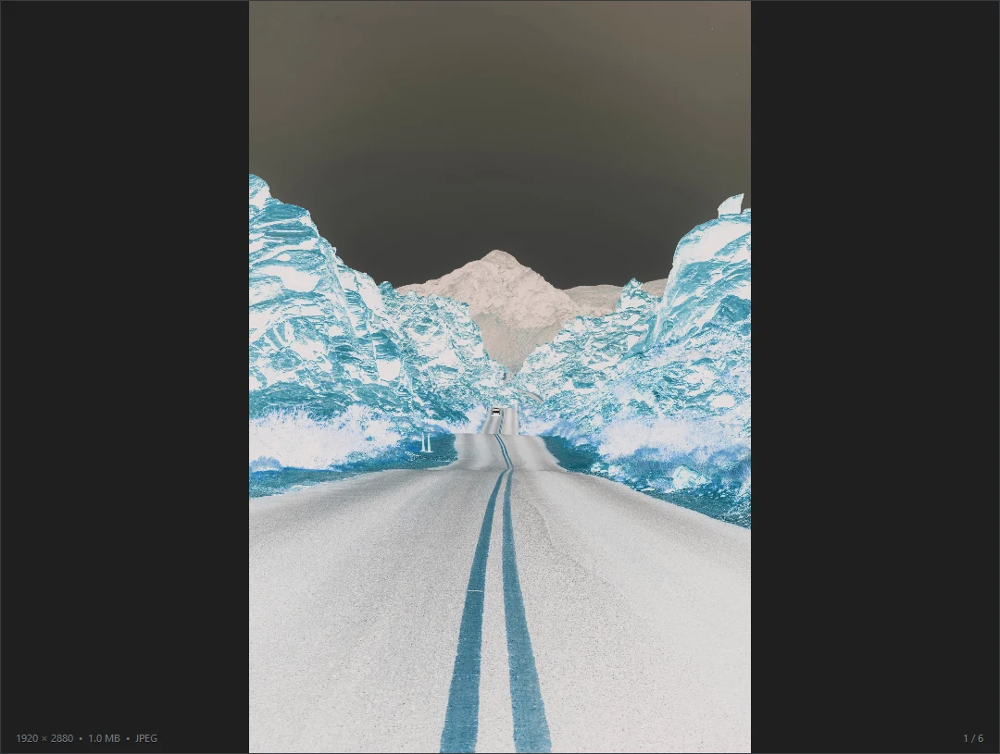
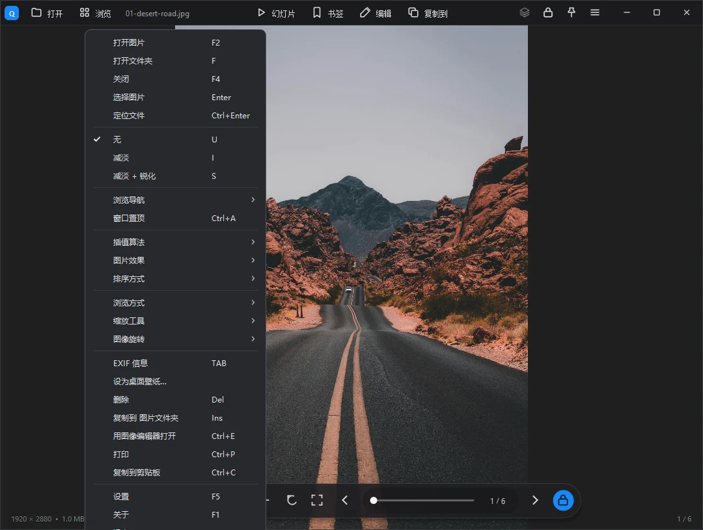
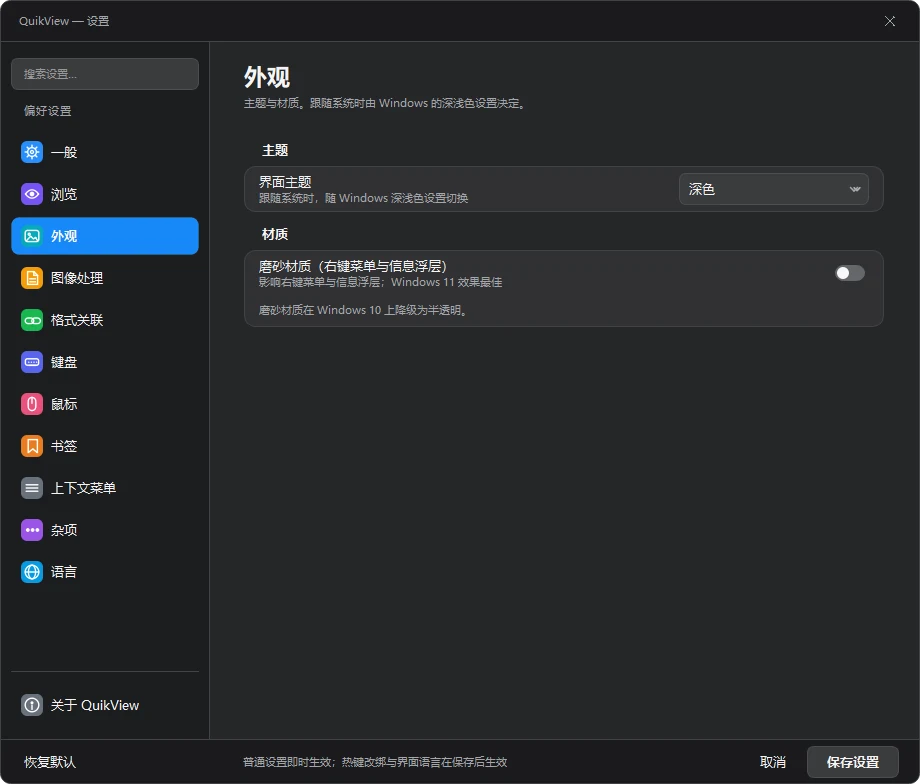

# QuikView

QuikView is an open-source Windows image viewer with folder navigation, two-page spreads, EXIF inspection, and batch conversion. Built with C++ and Qt 6 under the MIT license.

[](https://github.com/xdsT2/quikview/actions/workflows/ci.yml)
[](https://github.com/xdsT2/quikview/releases)

[简体中文](README.md) | **English**

> **Windows x64 downloads** · Choose the installer or portable ZIP from the [latest release](https://github.com/xdsT2/quikview/releases/latest). Extract and run the portable version without installing Qt.

> **0.4.1** refines the settings layout and light theme, applies changes such as theme selection immediately, and adds File Explorer context-menu previews, image info, and embedded PSD / PSB thumbnails. See the [release notes](https://github.com/xdsT2/quikview/releases/tag/v0.4.1).



> Most documentation is currently written in Chinese. This page mirrors `README.md`;
> for what is implemented and what is still missing
> see [ROADMAP.md](ROADMAP.md). Testing entry points (`--smoke` / `--probe`) and
> architecture trade-offs are in [ARCHITECTURE.md](ARCHITECTURE.md).

This is a from-scratch rewrite and contains no third-party proprietary code or binaries.
Its feature scope and architectural understanding came from reverse-engineering the installer of
Honeyview (a discontinued free viewer by Bandisoft) — but the two are separate works:
QuikView is an original implementation.

## Screenshots

Every screenshot is rendered by QuikView itself (not captured from the screen). Click one to see it
full size.

| Browsing & viewing | Effects & configuration |
|:--:|:--:|
| [](docs/SCREENSHOTS.md) | [](docs/SCREENSHOTS.md) |
| **Thumbnail browser**<br>Vertical rail, decoded async, never blocks | **Image info**<br>EXIF / GPS / histogram on `Tab` |
| [](docs/SCREENSHOTS.md) | [](docs/SCREENSHOTS.md) |
| **Double-page spread**<br>Photo books and comics side by side | **Image effects**<br>Invert / gamma / rotate / resampling |
| [](docs/SCREENSHOTS.md) | [](docs/SCREENSHOTS.md) |
| **Context menu**<br>Grouped, with shortcuts | **Settings**<br>Consistent layout in light and dark themes |

**[All 10 screenshots (with captions) →](docs/SCREENSHOTS.md)**

## Features

**Viewing core**

- Zoom / pan / fit to window / actual size / full screen
- Rotate 90° / flip horizontally and vertically / interactive crop (drag a box, press Enter) / proportional resize
- Slideshow with configurable interval, set as wallpaper

**Browsing**

- Directory sequence navigation (arrow keys / Page Up-Down / Space)
- Thumbnail browser panel on the left, thumbnails decoded asynchronously
- Animated GIF and multi-page TIFF frame stepping (Ctrl+←/→)
- Favorites and recent files

**Formats** (Qt6 plugins plus optional libraries)

- Common: PNG / JPEG / BMP / GIF / WebP / TIFF / ICO and more
- RAW: DNG / NEF / CR2 / ARW / RW2 and more (libraw)
- Modern: HEIC / AVIF (libheif)

**Metadata**

- EXIF / GPS panel with a hand-written parser (no GPL dependency), one-click jump to a map
- Histogram

**File operations**

- Save as (PNG / JPEG / BMP / WebP / TIFF), batch format conversion, printing

**Product details**

- Dark and light themes, settings dialog, 9 UI languages (Simplified/Traditional Chinese, English, Japanese, Korean, French, German, Spanish, Russian), portable mode
- No telemetry, no promotion

**Explorer integration** (`shell-ext/`, bare Win32 COM + WIC, no Qt dependency)

- File Explorer thumbnails for files with embedded PSD / PSB previews, plus context-menu commands for browsing, conversion, preview, and image info

## Build

Prerequisites: CMake ≥ 3.16, Qt 6 (Widgets / Concurrent / PrintSupport / LinguistTools),
optionally libraw / libheif (pkg-config).

Main application:

```bash
cmake -S . -B build -G Ninja -DCMAKE_BUILD_TYPE=Release -DCMAKE_PREFIX_PATH=/path/to/Qt
cmake --build build
```

Shell extension (Windows only, `shell-ext/`):

```bash
cmake -S shell-ext -B build-shell64 -G "MinGW Makefiles" -DCMAKE_BUILD_TYPE=Release
cmake --build build-shell64
# run shell-ext/scripts/Register-QuikThumb.ps1 as administrator to register
```

32-bit cross-build, self-test and unregistration: see [shell-ext/README.md](shell-ext/README.md).

One-liner with MSYS2:

```bash
pacman -S --needed mingw-w64-x86_64-{toolchain,cmake,ninja,qt6-base,qt6-imageformats,qt6-tools,libraw,libheif}
cmake -S . -B build -G Ninja -DCMAKE_BUILD_TYPE=Release -DCMAKE_PREFIX_PATH=/mingw64
cmake --build build
```

## Layout

```
src/          application sources (21 modules, ~17.6k lines of C++)
shell-ext/    Explorer shell extension: thumbnail + context menu (COM)
shell/        earlier shell extension: thumbnail + preview pane (kept for reference)
translations/ .ts language files (9 languages)
resources/    icons and UI artwork, all drawn for this project (see docs/ATTRIBUTION.md)
config/       portable configuration (config.ini, not tracked)
docs/         screenshots, asset provenance, design guidelines
packaging/    NSIS installer script
```

## Assets and licensing

All UI artwork (`resources/skin/`) and the application icon (`resources/quikview.ico`) were drawn
for this project. No third-party image assets are included. Size, byte count and SHA-256 of every
file are recorded in `resources/skin/PROVENANCE.json`; the `source` field distinguishes files that
are generated by script from baked bitmaps. The generator and its parameters are documented in
[docs/ATTRIBUTION.md](docs/ATTRIBUTION.md).

Third-party libraries and trademark notices: see [NOTICE](NOTICE).

## Disclaimer

- This project is an independent implementation. It is not affiliated with, authorized by, or
  endorsed by Honeyview or Bandisoft.
- It contains no Honeyview code, binaries, icons, skin assets or language files. UI dimensions,
  frame order and hit-box layout were implemented independently from publicly observable behavior.
- "Honeyview" and related trademarks belong to their respective owners.

## License

[MIT](LICENSE)
