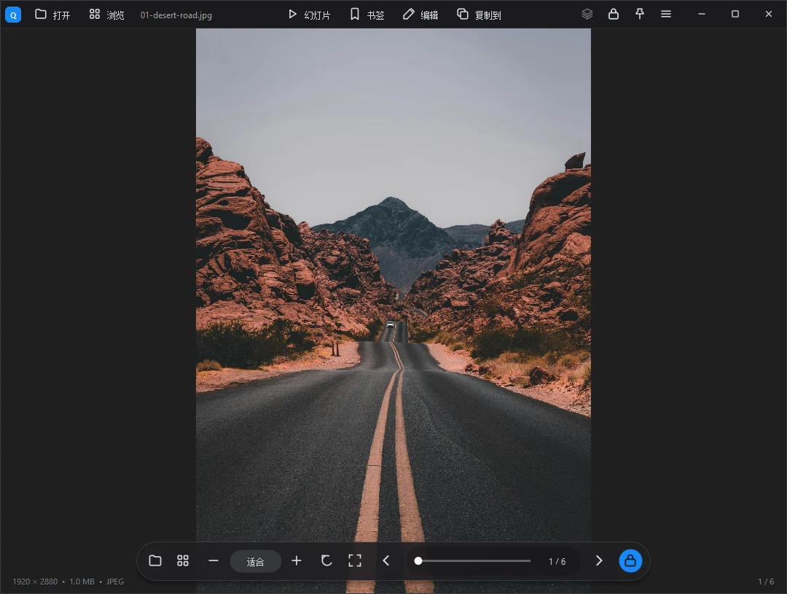
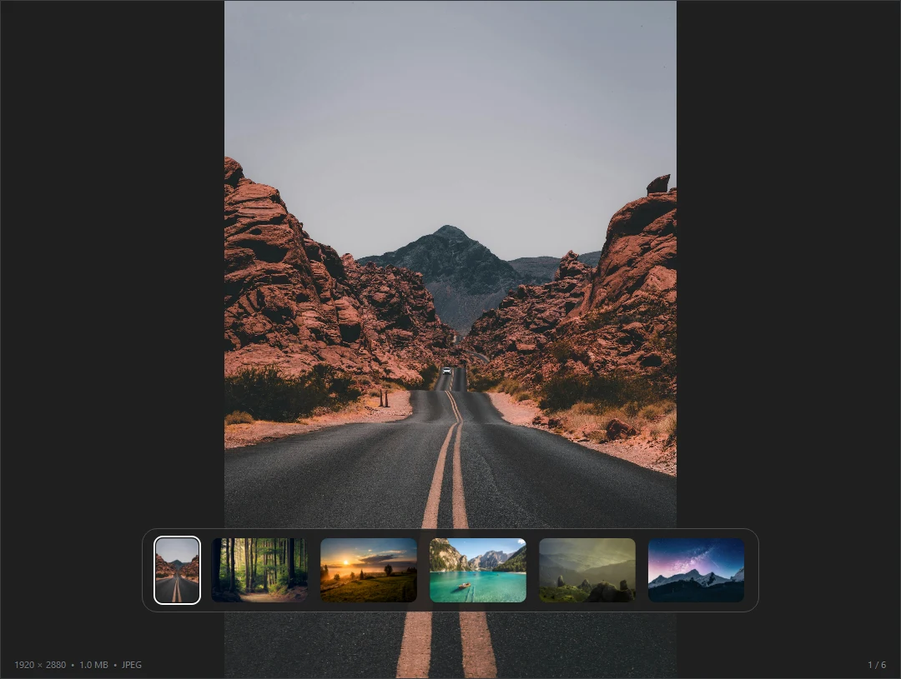
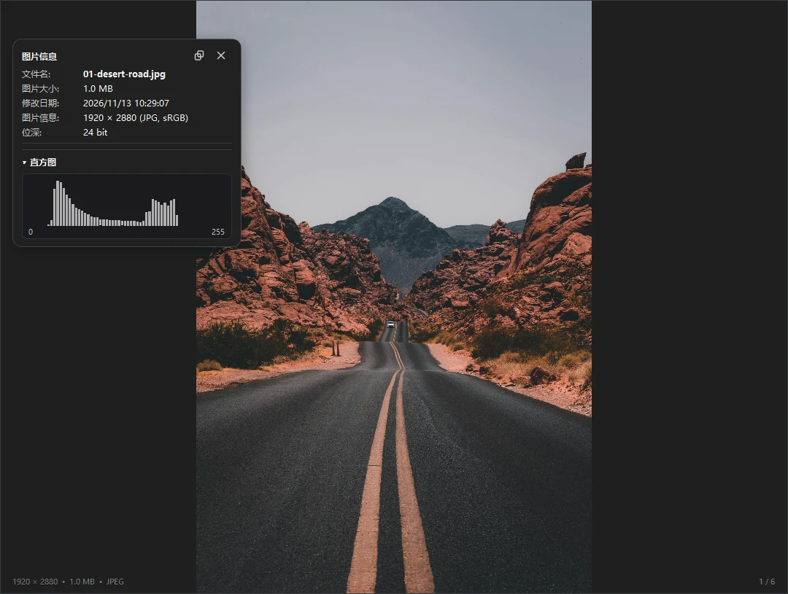
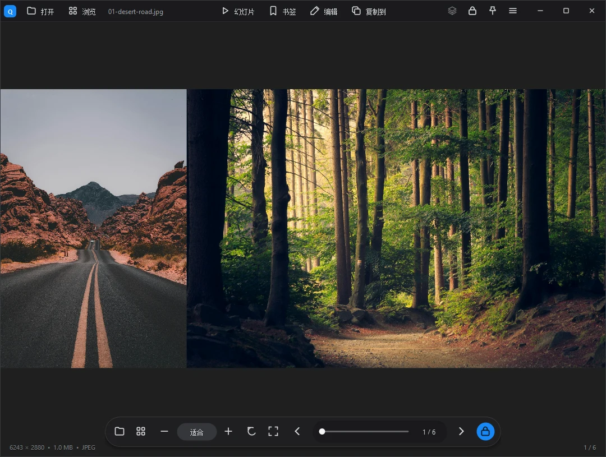
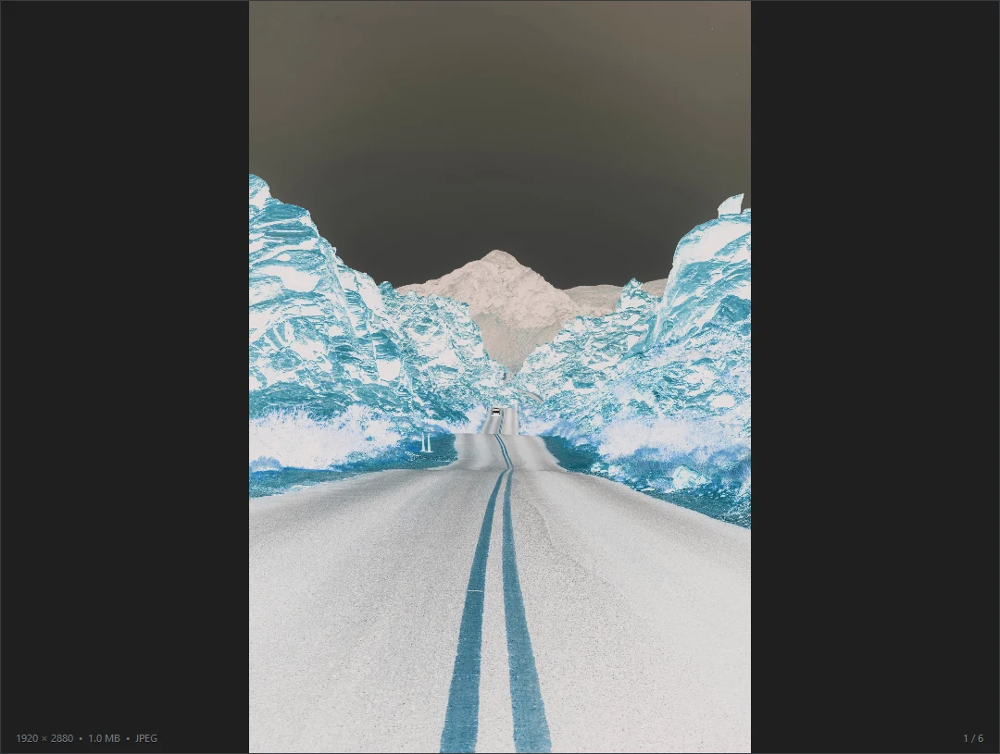
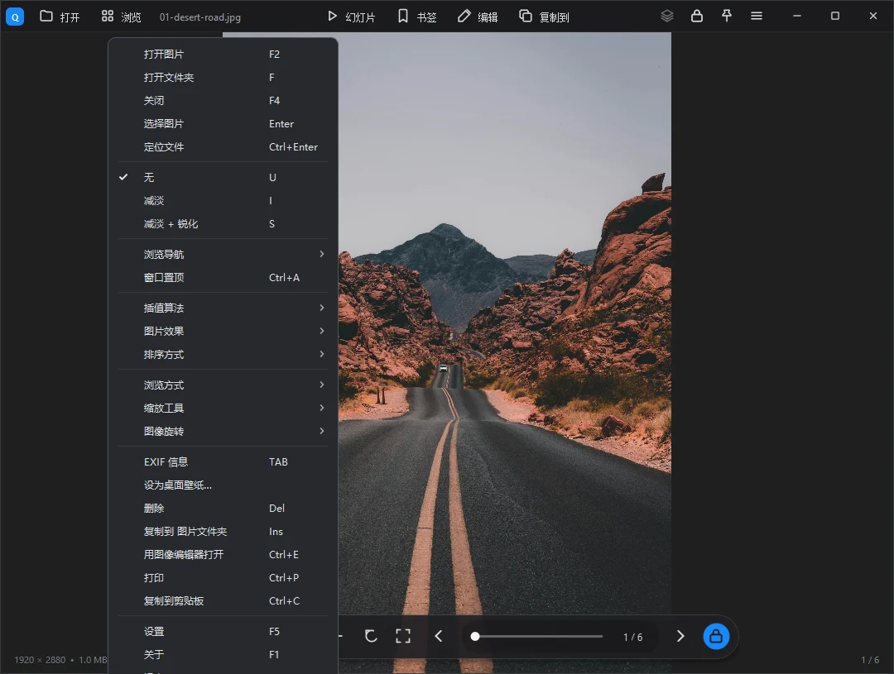
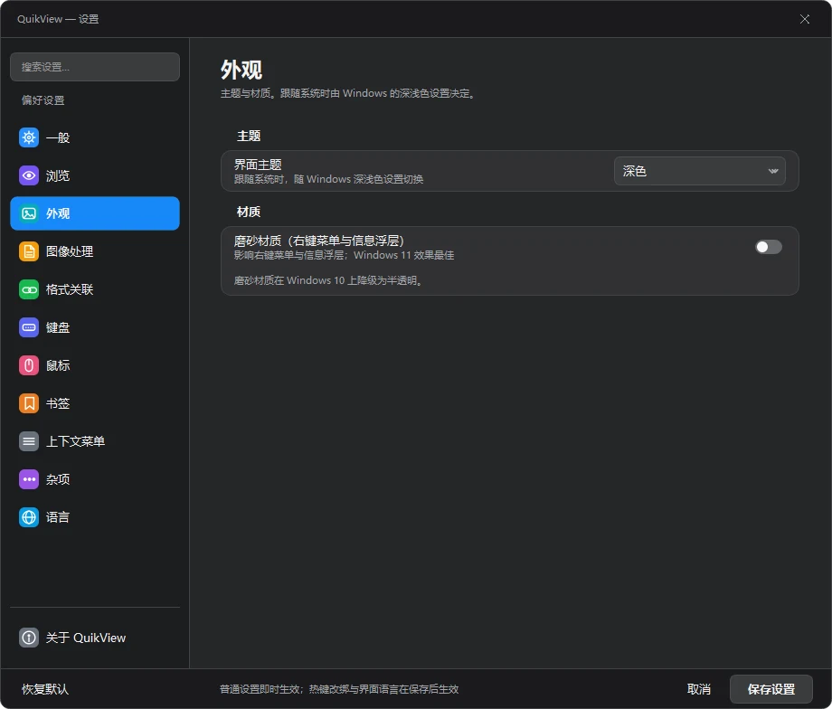

# QuikView

QuikView 是一款开源的 Windows 看图器，支持目录翻页、双页阅览、EXIF 查看和批量转换。使用 C++ 和 Qt 6 构建，采用 MIT 许可证。

[](https://github.com/xdsT2/quikview/actions/workflows/ci.yml)
[](https://github.com/xdsT2/quikview/releases)

**简体中文** | [English](README.en.md)

> **Windows x64 下载** · 到[最新发布页](https://github.com/xdsT2/quikview/releases/latest)选择安装版或便携 ZIP。便携版解压即可运行，无需另装 Qt。

> **0.4.1** 改善了设置页布局和浅色主题，主题等设置可即时应用。资源管理器集成新增右键预览和图片信息，并可显示带内嵌缩略图的 PSD / PSB 文件。详见 [版本说明](https://github.com/xdsT2/quikview/releases/tag/v0.4.1)。



> 想先知道**实现到什么程度、哪些还没做**？看 [ROADMAP.md](ROADMAP.md)。
> 自测入口（`--smoke` / `--probe`）与架构取舍见 [ARCHITECTURE.md](ARCHITECTURE.md)。

本项目**从零重写**，不包含任何第三方专有代码或二进制。其功能范围与架构理解，来自对 Honeyview（Bandisoft 已停更的免费看图器）官方安装包的逆向分析——但这是两个独立的工程：QuikView 是原创实现。

## 界面一览

截图全部由 QuikView 自己渲染（不是系统抓屏），点开任意一张看细节。

| 浏览与查看 | 效果与配置 |
|:--:|:--:|
| [](docs/SCREENSHOTS.md) | [](docs/SCREENSHOTS.md) |
| **缩略图浏览**<br>左侧竖排，异步生成，不卡界面 | **图片信息**<br>EXIF / GPS / 直方图，`Tab` 呼出 |
| [](docs/SCREENSHOTS.md) | [](docs/SCREENSHOTS.md) |
| **双页阅览**<br>画册、漫画并排看 | **图像效果**<br>反色 / Gamma / 旋转 / 插值 |
| [](docs/SCREENSHOTS.md) | [](docs/SCREENSHOTS.md) |
| **右键菜单**<br>按功能分组，标快捷键 | **设置**<br>统一布局，支持深浅主题 |

**[全部 10 张截图（含说明）→](docs/SCREENSHOTS.md)**


## 功能

**看图核心**
- 缩放 / 平移 / 适配窗口 / 实际大小 / 全屏
- 旋转 90° / 水平垂直翻转 / 交互式裁剪（框选 + 回车确认）/ 按比例调整大小
- 幻灯片（间隔可配）、设壁纸

**浏览**
- 目录序列切换（方向键 / 翻页 / 空格）
- 左侧缩略图浏览器（异步缩略图）
- 动画 GIF / 多页 TIFF 逐帧浏览（Ctrl+←/→）
- 收藏夹 + 最近打开

**格式**（Qt6 插件 + 扩展库）
- 常规：PNG / JPEG / BMP / GIF / WebP / TIFF / ICO 等
- RAW：DNG / NEF / CR2 / ARW / RW2 等（libraw）
- 现代：HEIC / AVIF（libheif）

**元数据**
- EXIF / GPS 面板（自研解析器，无 GPL 依赖），GPS 一键跳转地图
- 直方图

**文件**
- 另存为（PNG/JPEG/BMP/WebP/TIFF）、批量格式转换、打印

**产品化**
- 深色 / 浅色主题、设置界面、9 种界面语言（简繁中文、英、日、韩、法、德、西、俄）、便携模式
- 零遥测、零推广（对照逆向出的"坑清单"反向设计）

**系统集成**（`shell-ext/` 子项目，纯 Win32 COM + WIC，不依赖 Qt）
- 资源管理器缩略图（包括带内嵌缩略图的 PSD / PSB）与右键浏览、转换、预览、图片信息

## 构建

前置：CMake ≥ 3.16、Qt 6（Widgets / Concurrent / PrintSupport / LinguistTools）、可选 libraw / libheif（pkg-config）。

主程序：

```bash
cmake -S . -B build -G Ninja -DCMAKE_BUILD_TYPE=Release -DCMAKE_PREFIX_PATH=/path/to/Qt
cmake --build build
```

壳扩展（仅 Windows，`shell-ext/`）：

```bash
cmake -S shell-ext -B build-shell64 -G "MinGW Makefiles" -DCMAKE_BUILD_TYPE=Release
cmake --build build-shell64
# 管理员注册：shell-ext/scripts/Register-QuikThumb.ps1
```

32 位交叉构建、自测与卸载见 [shell-ext/README.md](shell-ext/README.md)。

MSYS2 一键：

```bash
pacman -S --needed mingw-w64-x86_64-{toolchain,cmake,ninja,qt6-base,qt6-imageformats,qt6-tools,libraw,libheif}
cmake -S . -B build -G Ninja -DCMAKE_BUILD_TYPE=Release -DCMAKE_PREFIX_PATH=/mingw64
cmake --build build
```

## 目录结构

```
src/          主程序源码（21 个模块，约 1.76 万行 C++）
shell-ext/    资源管理器壳扩展：缩略图 + 右键菜单（COM）
shell/        早期壳扩展实现：缩略图 + 预览窗格（保留备查）
translations/ 语言文件（9 种语言的 .ts）
resources/    图标与界面素材（全部原创绘制，见 docs/ATTRIBUTION.md）
config/       便携配置（config.ini，不入库）
docs/         截图、素材来源与设计规范
packaging/    NSIS 安装包脚本
```

## 素材与许可

界面素材（`resources/skin/`）与应用图标（`resources/quikview.ico`）全部为本项目程序化绘制，
不含任何第三方图像素材。每个文件的尺寸、字节数与 SHA-256 记在
`resources/skin/PROVENANCE.json`（`source` 字段区分脚本生成与烘焙两类）；
生成器与设计参数见 [docs/ATTRIBUTION.md](docs/ATTRIBUTION.md)。

第三方库与商标声明见 [NOTICE](NOTICE)。

## 免责声明

- 本项目为独立实现，与 Honeyview / Bandisoft 无任何从属、授权或背书关系。
- 不包含任何 Honeyview 的代码、二进制、图标、皮肤素材或语言文件；
  界面尺寸、帧序与热区布局参照其公开可观察行为自行实现。
- "Honeyview" 及相关商标归其权利人所有。

## 许可证

[MIT](LICENSE)
