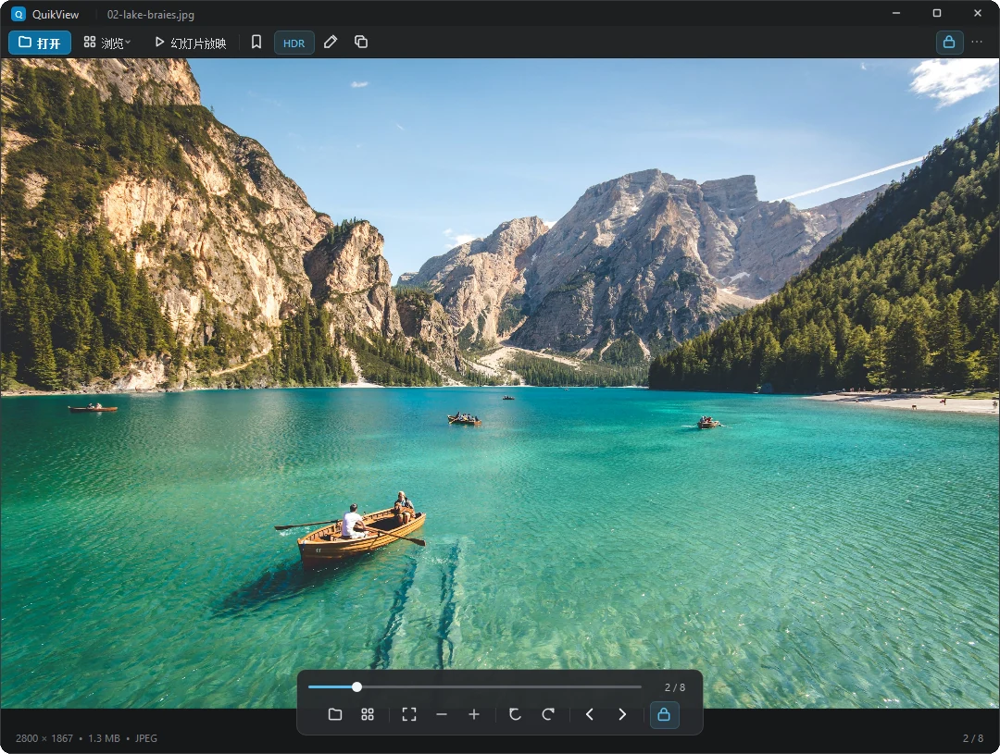
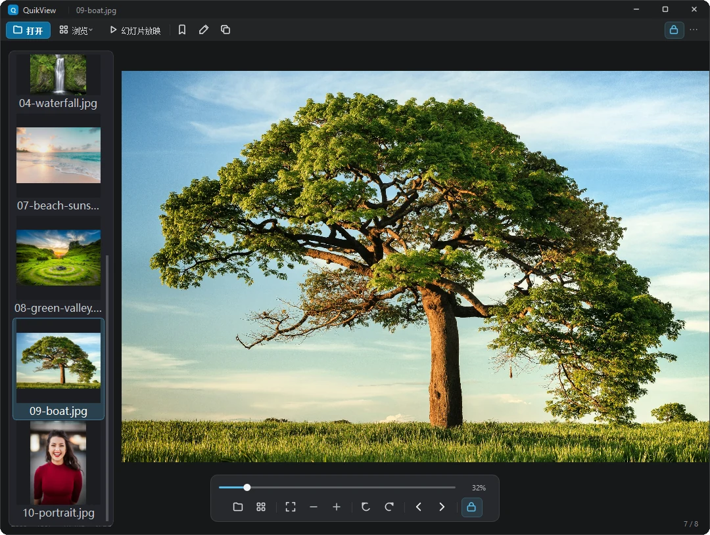
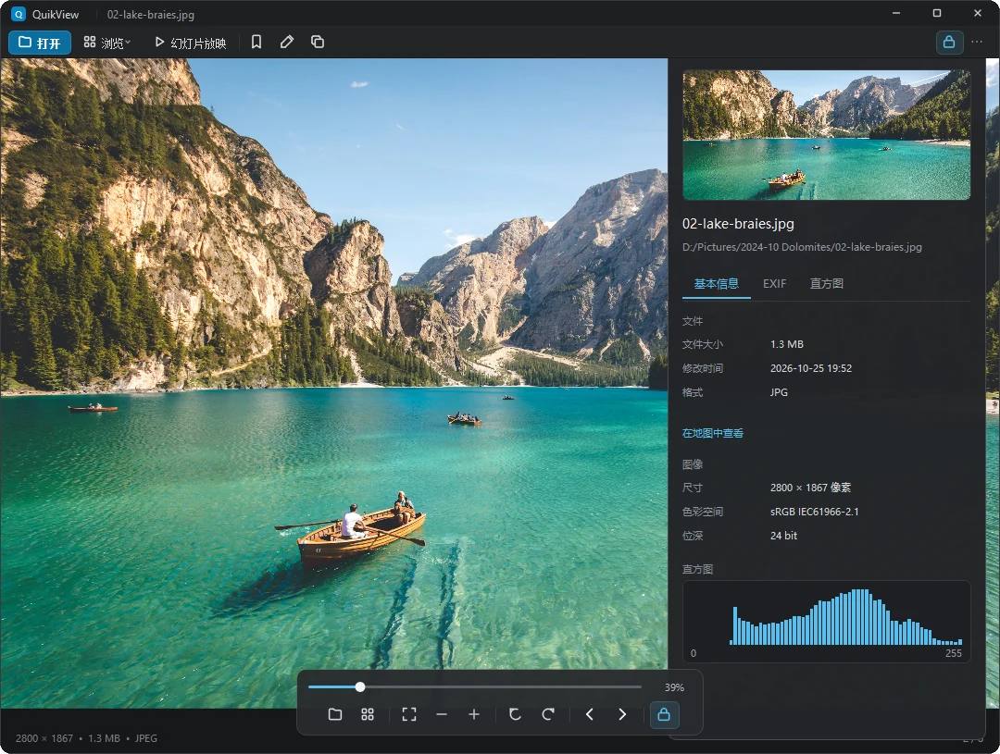
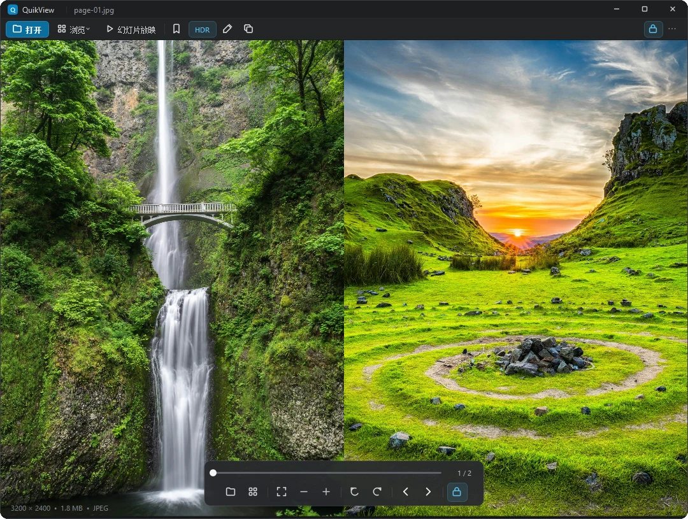
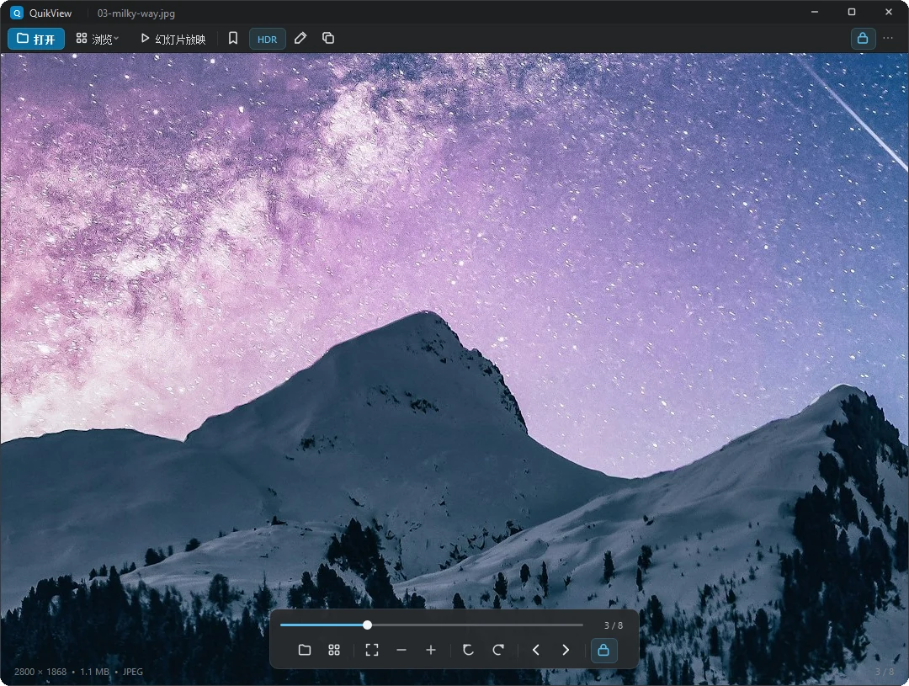
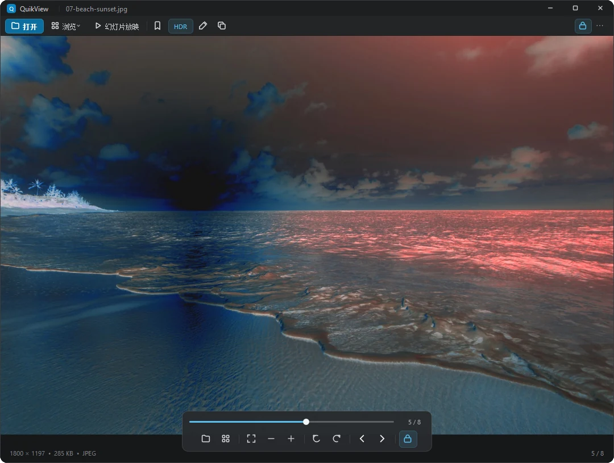
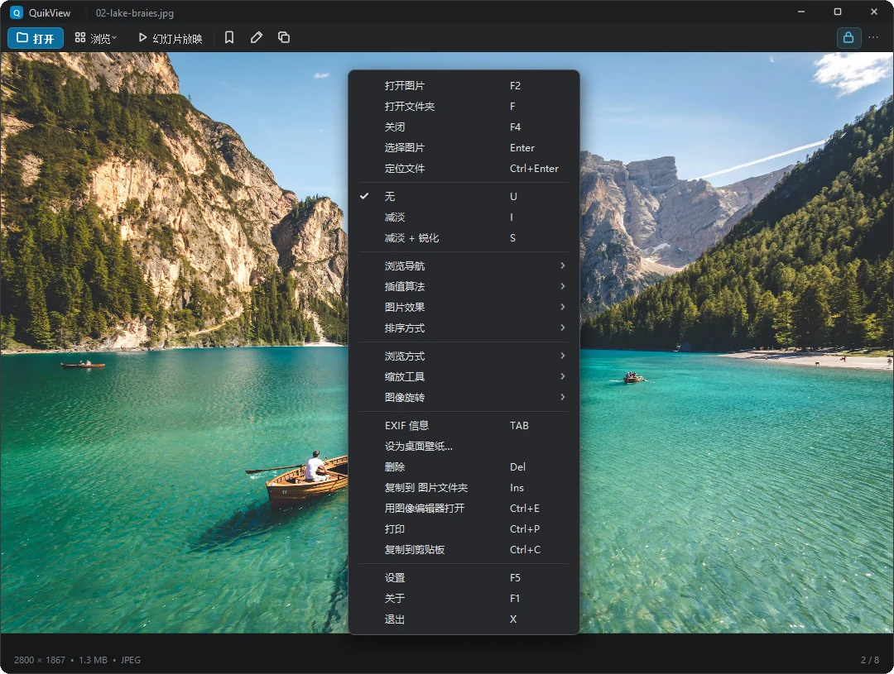
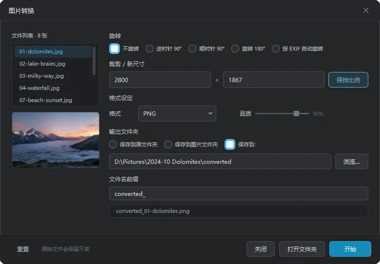
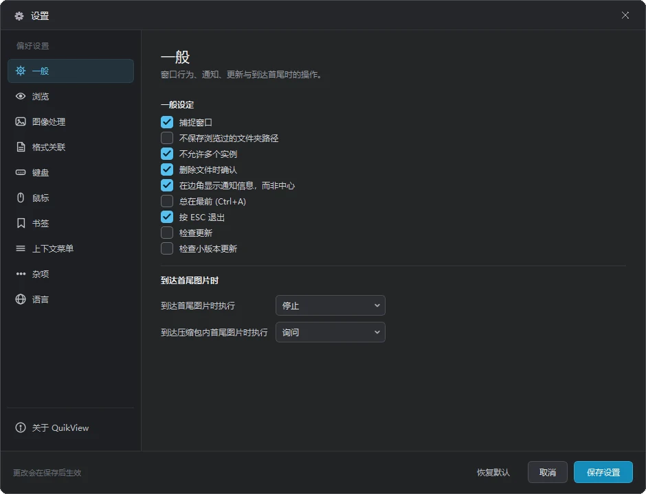
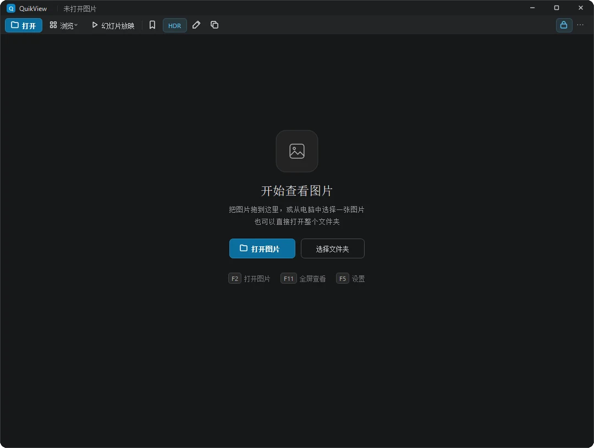

# 界面一览 · Screenshots

[← 返回 README](../README.md)

以下截图全部由 **QuikView 自身渲染**（`--screenshot` 走 Qt 内部绘制，不是系统抓屏），
所以不受显示器 DPI 缩放影响，和你在屏幕上看到的一致。

Every screenshot below is rendered by QuikView itself (`--screenshot`, Qt's own painting),
not captured from the screen — so it is DPI-independent and matches what you actually see.

---

## 1. 打开即看 · Open and view

双击图片直接看。顶部栏和底部胶囊浮在画面上，鼠标移开就淡出，画面永远是满的。

Double-click any image. The top strip and bottom capsule float over the picture and fade out
when the pointer leaves — the image always gets the whole window.

---

## 2. 缩略图浏览 · Thumbnail browser

左侧竖排缩略图，异步生成，点一下就换。文件夹里有几百张也不会卡住界面。

Vertical thumbnail rail on the left, generated asynchronously. Click to switch; a folder with
hundreds of files will not block the UI.

---

## 3. 图片信息 · Image info

`Tab` 呼出左上角信息卡片：文件名、体积、修改时间、位深、相机制造商 / 型号 / 软件、拍摄时间、
GPS（可一键在地图上查看），直方图折叠在底部。卡片浮在画面上，不挤压图片。EXIF 是自研解析器，
不依赖任何 GPL 库。

`Tab` brings up the info card at the top-left: file name, size, modified time, bit depth, camera
make / model / software, capture time, GPS (with a "show on map" link), and a collapsible
histogram. The card floats over the image instead of squeezing it. The EXIF parser is our own —
no GPL dependency.

---

## 4. 双页阅览 · Double-page spread

画册、漫画、扫描件并排看，缩放到跨页宽度，翻页一次翻两页。

For photo books, comics and scans: two pages side by side at spread width, one keypress per spread.

---

## 5. 1:1 看像素 · 100% pixel view

切到实际大小，一张 2800×1867 的原图按像素铺满窗口，噪点和星点都看得见，不是插值糊出来的。

Switch to actual size: a 2800×1867 original laid out pixel for pixel — noise and stars stay
visible instead of being smoothed away.

---

## 6. 图像效果 · Image effects

反色、Gamma 校正、旋转、翻转、缩放插值（最近邻 / 双线性 / Lanczos）。只影响显示，不动原文件。

Invert, gamma, rotate, flip, and resampling mode (nearest / bilinear / Lanczos).
Display only — the file on disk is untouched.

---

## 7. 右键菜单 · Context menu

按功能分组：打开、滤镜、浏览、缩放旋转、文件操作、设置。每个常用项都标了快捷键。

Grouped by purpose: open, filters, navigation, zoom/rotate, file actions, settings — each with its
keyboard shortcut on the right.

---

## 8. 批量转换 · Batch convert

格式、尺寸、质量、输出目录一次设好，整个列表一起转。原文件默认保留。

Format, size, quality and output folder set once — the whole file list converts in one go.
Originals are kept by default.

---

## 9. 设置 · Settings

左侧十个分类，右侧就地生效的选项：一般、浏览、图像处理、格式关联、键盘、鼠标、书签、上下文菜单、杂项、语言。

Ten categories on the left, options on the right: general, browsing, image processing, file
associations, keyboard, mouse, bookmarks, context menu, misc, language.

---

## 10. 启动画面 · Start screen

没打开图的时候也不空着：拖进来、选图片、或者直接打开整个文件夹。

Nothing open? Drop a file in, pick one, or open a whole folder.

---

## 关于示例照片 · About the sample photos

截图里的风光照来自 [Unsplash](https://unsplash.com/license)（Unsplash License，可免费使用）。
它们**只出现在截图里**，不随程序分发，也不在仓库的其它位置出现。EXIF 字段为演示用。

The landscape photos are from [Unsplash](https://unsplash.com/license) and appear **only inside
these screenshots**; they are not shipped with the program. EXIF values are for demonstration.
